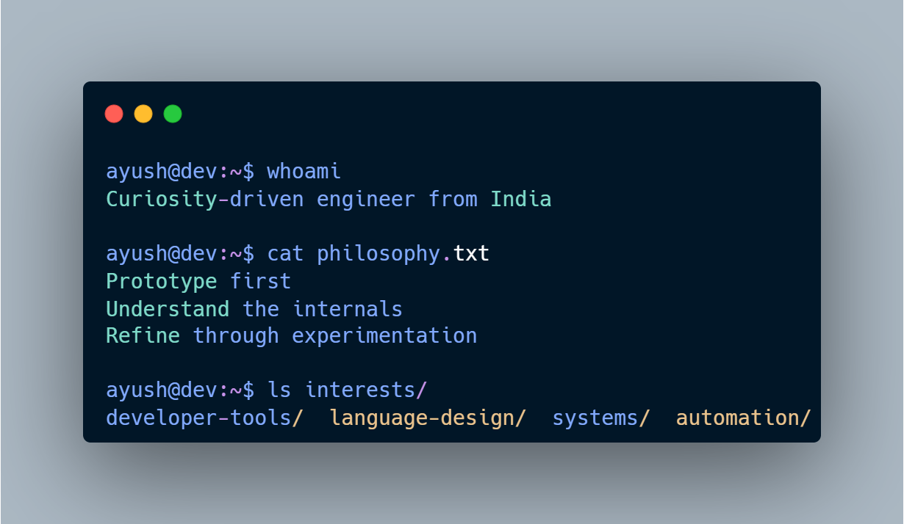

# Ayush Dubey // Experimental Engineer

  <samp>
    BUILDING TOOLS · EXPLORING LANGUAGES · UNDERSTANDING SYSTEMS
  </samp>

  <a href="https://jo-sh.vercel.app">Portfolio</a> •
  <a href="https://github.com/journeycodesayush">Repositories</a> •
  <a href="https://www.linkedin.com/in/journeycodesayush/">LinkedIn</a> •
  <a href="mailto:journeycodes.ayush@gmail.com">Email</a>

---

  

I enjoy building software to understand how things work beneath the surface. My projects range from command-line utilities and desktop tools to toy programming languages and interactive web experiences.

I prefer **learning by building**: start with an idea, get a working prototype, explore the engineering challenges, and improve what makes sense.

---
## `01` / Engineering Toolkit

### Languages

 

### Web & Backend

 

### Tools & Environment

 

### Currently Exploring

<code>Spring Boot</code>
<code>System Design</code>
<code>DSA</code>
<code>Backend Engineering</code>

---

## `02` / GitHub Telemetry

  
  

  

---

## `03` / Connect

  
  
  
  

